# SIKLUS HIDUP WORKFLOW, SPRINT 0 BLUEPRINTING (`docs/00`–`11`) & STATE MACHINE MILESTONE
# Version: 5.2.0 | Scope: Sprint 0 Interactive Blueprinting (`docs/00`–`11` with Early Infrastructure at `05`), Agile Scrum Lifecycle, Dual Execution Mode, JIT Branching & Multi-Gate DoD

## 1. Siklus Transisi Sprint 0 (Discovery & Blueprinting) ke Eksekusi Sprint: Dual Execution Mode

Untuk menjamin bahwa AI **tidak pernah mengimajinasikan sendiri** kebutuhan konsumen, arsitektur, maupun infrastruktur (*no one-shot coding*), seluruh proyek atau fitur besar wajib melewati **Sprint 0 (5-Stage Interactive Discovery & Blueprinting Gates `docs/00` s.d. `docs/11`)** secara sekuensial dari Hulu ke Hilir sebelum memasuki eksekusi kode:

```mermaid
flowchart TD
    Init["Inisiasi Proyek / Fitur Baru<br/>1. Cek Versi Governance (check-governance-update.sh --check)<br/>🛑 AI WAJIB TANYA:<br/>'Mode WORK TEAM (Scrum Team) atau INDIVIDU (Solo Agile)?'"] --> S0_Check{"SPRINT 0 CHECK:<br/>Apakah docs/00 s.d. docs/11 sudah ada & APPROVED?"}

    subgraph Sprint0Path ["Fase Hulu Wajib: SPRINT 0 — 5-Stage Interactive Customer Discovery & Blueprinting (Berlaku untuk KEDUA Mode!)"]
        Stage1["Stage 1 (Bisnis & Kebutuhan): Wawancara Vision, Req, Biz Process & PRD<br/>-> Plan Flowchart & User Stories -> Proceed -> Buat docs/00, 01, 02, 03"] --> Stage2["Stage 2 (Arsitektur & Infrastruktur di Hulu!): Wawancara Tech Stack, Hosting, Docker/Native, Port, DB Engine & CI/CD<br/>-> Plan Diagram Arsitektur & Topologi Infrastruktur -> Proceed -> Buat docs/04, 05"]
        Stage2 --> Stage3["Stage 3 (Data & API): Wawancara Database Relations (ERD) & API Contracts<br/>-> Plan Mermaid erDiagram & Endpoint Payload -> Proceed -> Buat docs/06, 07"]
        Stage3 --> Stage4["Stage 4 (UI/UX & Keamanan): Wawancara UI/UX Design, Wireframe, Screen Flow & RBAC/Security<br/>-> Plan ASCII/Visual Mockup UI per Layar & Matriks RBAC -> Proceed -> Buat docs/08, 09"]
        Stage4 --> Stage5["Stage 5 (Rencana Eksekusi & Uji): Wawancara Granular Sprint Backlog & Test Plan<br/>-> Plan Multi-Task Roadmap (Dilarang 1 Task Raksasa!) -> Proceed -> Buat docs/10, 11 & TEAM-BOARD"]
    end

    S0_Check -->|Belum Lengkap| Stage1
    Stage5 --> ModeChoice{"Masuk ke Sprint 1 Execution:<br/>Pilihan Mode Eksekusi per Task (TASK-001, TASK-002, dst.)"}
    S0_Check -->|Sudah Lengkap & APPROVED| ModeChoice

    subgraph WorkTeamPath ["Jalur A: Mode WORK TEAM (Multi-Worker Scrum Team Track)"]
        W2["State 2A: Set Default Branch ke feature/TASK-XXX (Sprint Branch)"] --> W3["State 3A: Sprint Assignment Gate (Delegasi Scrum Developer)"]
        W3 --> W4["State 4A: Validasi Akun GitHub CLI & DoR Check (Gate 0)"]
        W4 --> W6["State 6A: JIT Branching (task/TASK-XXX-worker)"]
        W6 --> W7["State 7A: Task Design (Plan & Proceed merujuk docs/00-11) -> Koding & Backup .trash/"]
        W7 --> W8["State 8A: Daily Scrum Async Sync (Update Doing/Blockers)"]
        W8 --> W9["State 9A: Gate 1 (DoD L1) AI Automated Tests (100% PASS)"]
        W9 --> W10["State 10A: Gate 2 (DoD L2) Handover [PENDING] -> AI STOP"]
        W10 --> W11["State 11A: Gate 2 Human Dev AC Verification [x] PASSED"]
        W11 --> W12["State 12A: Commit & Push task/* atas Izin User"]
        W12 --> W13["State 13A: Gate 3 (DoD L3) PR Review & Merge ke feature/* + Update Burndown"]
        W13 --> W14["State 14A: Post-Merge Cleanup (Hapus remote task/*)"]
        W14 --> W15["State 15A: Gate 4 (DoD L4 - Sprint Review) PO Smoke Acceptance [x] COMPLETED"]
        W15 --> W16["State 16A: Sprint Retrospective -> PR feature/* ke development & Lanjut TASK-(X+1)"]
    end

    subgraph IndividuPath ["Jalur B: Mode INDIVIDU (Solo Agile / Scrum-of-One Track)"]
        I2["State 2B: Checkout feature/TASK-XXX dari dev<br/>(TANPA MEMBUAT task/*, Eksekusi 1 Task Granular per Iterasi)"] --> I3["State 3B: Validasi Identitas Solo Dev & DoR Check (Gate 0)"]
        I3 --> I4["State 4B: Task Design (Plan & Proceed merujuk docs/00-11) -> Koding & Backup .trash/"]
        I4 --> I5["State 5B: Gate 1 (DoD L1) AI Automated Tests (100% PASS)"]
        I5 --> I6["State 6B: Gate 2 (DoD L2) Handover [PENDING] -> AI STOP TOTAL"]
        I6 --> I7["State 7B: Gate 2 Human Solo Dev AC Verification [x] PASSED"]
        I7 --> I8["State 8B: Update Burndown/Retrospective -> Commit & Push feature/* atas Izin"]
        I8 --> I9["State 9B: PR feature/TASK-XXX ke development & Merge -> Lanjut ke TASK-(X+1)"]
    end

    ModeChoice -->|Pilih WORK TEAM| W2
    ModeChoice -->|Pilih INDIVIDU| I2
```

---

## 2. Rincian Fase Hulu: Sprint 0 (5-Stage Interactive Discovery & Blueprinting `docs/00`–`11`)

Sebelum masuk ke Jalur A (`WORK TEAM`) maupun Jalur B (`INDIVIDU`), AI **WAJIB** menyelesaikan 5 gerbang perancangan dokumen di folder `docs/` melalui wawancara mendalam bersama pengguna:
1. **Stage 1 (`docs/00`, `01`, `02`, `03`)**: Menggali visi produk, kebutuhan fungsional/non-fungsional, alur bisnis end-to-end (Flowchart), dan *User Stories (Given-When-Then)*. Diajukan di `implementation_plan.md` $\rightarrow$ tunggu **Proceed** $\rightarrow$ tulis dokumen.
2. **Stage 2 (`docs/04`, `05`) — *Dikunci di Hulu Sebelum Data/API/UI!***: Menggali arsitektur kode (`04-architecture.md`) serta **Infrastruktur & Topologi Deployment (`05-infrastructure.md`)**: target hosting (Local/VPS/Cloud), Docker Compose vs Native, engine Database/Cache/Storage, alokasi Port, Reverse Proxy, `.env`, dan CI/CD. Diajukan di `implementation_plan.md` $\rightarrow$ tunggu **Proceed** $\rightarrow$ tulis dokumen.
3. **Stage 3 (`docs/06`, `07`)**: Mengikuti engine database yang telah dikunci di `05-infrastructure.md`, menggali skema database, **relasi antar tabel (ERD `erDiagram` di `06-database.md`)**, indexing, seeder, serta kontrak endpoint API (`07-api.md`). Diajukan di `implementation_plan.md` $\rightarrow$ tunggu **Proceed** $\rightarrow$ tulis dokumen.
4. **Stage 4 (`docs/08`, `09`)**: Menggali desain UI/UX, menyajikan **Wireframe / Mockup Layout per layar** & *Screen Flow* (`08-ui-ux.md`), serta standar autentikasi, matriks RBAC, dan keamanan (`09-security.md`). Diajukan di `implementation_plan.md` $\rightarrow$ tunggu **Proceed** $\rightarrow$ tulis dokumen.
5. **Stage 5 (`docs/10`, `11`, `.ai/TEAM-BOARD.md`)**: Menggali peta jalan Sprint yang memecah aplikasi ke dalam beberapa Task modular (`TASK-001`, `TASK-002`, `TASK-003`, dst. di `10-development-plan.md` — **dilarang membuat 1 task full-stack sekaligus!**) beserta rencana pengujian Multi-Gate (`11-test-plan.md`). Diajukan di `implementation_plan.md` $\rightarrow$ tunggu **Proceed** $\rightarrow$ tulis dokumen.

---

## 3. Rincian Perbedaan Kedua Mode Eksekusi Kode (Pasca-Sprint 0)

### Jalur A: Mode WORK TEAM (Multi-Worker Scrum Team Track)
1. **Penerapan**: Digunakan ketika setiap Task/Sprint pada `docs/10-development-plan.md` dikerjakan oleh beberapa *Scrum Developer* berbeda secara paralel atau bertahap.
2. **Branching**: Base integrasi Sprint `feature/TASK-XXX` + cabang tugas *ephemeral* `task/TASK-XXX-worker`.
3. **Default Branch**: Disetel sementara ke `feature/TASK-XXX` selama Sprint aktif berlangsung.
4. **Tingkatan Gerbang**: **DoR + Multi-Gate Penuh (Gate 0 s.d. Gate 4)**.

### Jalur B: Mode INDIVIDU (Solo Agile / Scrum-of-One Track)
1. **Penerapan**: Digunakan ketika proyek dikerjakan secara mandiri oleh satu developer tunggal (*Solo Developer*), namun **tetap wajib melalui Sprint 0 (`docs/00`–`11`) dan dieksekusi bertahap per Task modular (`TASK-001`, lalu `TASK-002`, dst.)**.
2. **Branching**: **Hanya satu cabang `feature/TASK-XXX`** per Task dibuat langsung dari `development`. **DILARANG membuat cabang `task/*`**.
3. **Default Branch**: Tetap berada di `development`.
4. **Tingkatan Gerbang**: **DoR + Lightweight Dual-Gate per Task (Gate 0 s.d. Gate 2 SAJA)**. Setelah `TASK-001` lulus Gate 2 dan di-merge ke `development`, barulah developer memulai `TASK-002`.
