# SISTEM PENJAMINAN MUTU MULTI-GATE & SCRUM DEFINITION OF DONE (GATE 0–4)
# Version: 5.0.0 | Date: 2026-10-30 | Scope: Multi-Gate Lifecycle, Agile DoR/DoD, gh-Only Identity & Strict AI vs Human Testing Domain Separation

> [!NOTE]
> Dokumen ini adalah spesifikasi rujukan detail. Jika terdapat pertentangan, `.governance/CORE-RULES.md` adalah Single Source of Truth tertinggi yang berlaku.

```mermaid
flowchart TD
    Start["Request Pengguna / Sprint Backlog Item"] --> G0{"GATE 0: gh-Only Identity & DoR Check<br/>(AI Domain: gh api user + Permission API + DoR)"}
    
    G0 -->|Belum Login / Offline / DoR Gagal| G0_Fail["❌ FAIL-CLOSED REJECT:<br/>1. Dilarang Buat Implementation Plan<br/>2. Dilarang Eksekusi / Ubah File<br/>3. Berhenti & Arahkan gh auth login / Penuhi DoR"]
    G0 -->|Sesi Sah & Memenuhi DoR| Plan["Tahap Perancangan (Task Design):<br/>Penyusunan Implementation Plan (User Story AC)<br/>(Artifact RequestFeedback: true)"]
    
    Plan --> Approval{"Persetujuan Manusia<br/>(Tekan Tombol 'Proses')"}
    Approval -- "Belum Ditekan / Revisi" --> RevisePlan["Revisi Implementation Plan"]
    
    Approval -- "Tombol 'Proses' Ditekan" --> G0_Recheck{"Gate 0 gh-Only Re-Check<br/>(Konfirmasi Identitas Tetap Sah)"}
    
    subgraph WorkerUnit ["Scrum Developer Unit (1 Human Developer + 1 AI Assistant)"]
        G0_Recheck -- "Lolos" --> Exec["Sprint Execution: Koding, Backup .trash/ & Daily Standup Update"]
        Exec --> G1["Gate 1 (DoD Level 1): AI Automated Verification<br/>(AI Domain: Tests 100% PASS, Build Clean)"]
        G1 -->|Lolos| Handover["Gate 2 Handover (DoD Level 2):<br/>AI Buat Skenario Given-When-Then, Langkah & Expected Output<br/>Status Awal: [ ] PENDING<br/>🛑 AI STOP TOTAL! Serahkan ke Dev"]
        Handover --> Dev["Human Scrum Developer<br/>(Uji Nyata Acceptance Criteria di Terminal Lokal)"]
        Dev -->|Hasil Terverifikasi Nyata| G2["Gate 2 (DoD Level 2): Human Verification<br/>(Human Beri Arahan -> AI Tandai [x] PASSED)"]
    end

    subgraph Kepemimpinan ["Human Product Owner & Tech Lead (Repository Owner)"]
        G2 -->|Commit & Ajukan PR ke feature/| G3["Gate 3 (DoD Level 3): Pre-Merge Review & Platform Checks<br/>(AI Siapkan Summary + Update Burndown, PO Review & Merge)"]
        G3 --> Cleanup["Post-Merge Cleanup:<br/>Hapus branch remote task/* di GitHub"]
        Cleanup --> G4Handover["Gate 4 Handover (DoD Level 4 - Sprint Review):<br/>AI Buat Skenario Smoke Test Integrasi & Draf Retrospective<br/>Status Awal: [ ] PENDING<br/>🛑 AI STOP TOTAL! Serahkan ke PO"]
        G4Handover --> PO["Human Product Owner<br/>(Sprint Review: Uji Increment terhadap Sprint Goal)"]
        PO -->|Sign-Off Resmi Diterima| G4["Gate 4 (DoD Level 4): PO Final Acceptance & Sprint Retrospective<br/>(PO Nyatakan COMPLETED -> Sprint Closed & Merge ke dev)"]
    end
```

---

## 0. Gate 0: gh-Only Identity Handshake & Definition of Ready (DoR) (AI Domain)
- **Pelaksana**: AI Engine (Otomatis & Deterministik).
- **Mekanisme**: Menjalankan `gh api user --jq '{login: .login, id: .id}'`, memvalidasi wewenang akun terhadap `.ai/TEAM-BOARD.md`, serta memastikan item telah memenuhi **Definition of Ready (DoR)** (*User Story ID*, *Acceptance Criteria Given-When-Then*, *Story Points*, dan prasyarat hulu berstatus `MERGED`).
- **Kriteria Valid**: Sesi aktif terotentikasi, cocok dengan `Assigned Developer` yang sah, dan DoR terpenuhi.
- **Fail-Closed Hard Refusal**: Jika sesi belum login, offline, mismatch, atau DoR belum lengkap, AI **WAJIB MENOLAK SEKETIKA (FAIL-CLOSED)** membuat plan maupun menyentuh berkas apa pun.

---

## 1. Gate 1 (DoD Level 1): AI Automated Verification (AI Domain - 100% Passing Rate)
- **Pelaksana**: Worker AI di komputer lokal.
- **Cakupan**: Automated unit tests (`go test`, `pytest`), race detection, type checking, linting, dan build verification untuk memastikan *Increment* bebas dari regresi teknis.
- **Standar Lolos**: 100% test lulus tanpa kegagalan (`0 failures, 0 errors`), kompilasi bersih tanpa peringatan kritis. Bukti eksekusi disajikan transparan.

---

## 2. Gate 2 (DoD Level 2): Human Developer Operational & Acceptance Criteria Verification (Human Exclusive Domain)
- **Pelaksana Eksklusif**: **Human Scrum Developer**.
- **Kewenangan & Larangan Keras AI**:
  - **AI DILARANG KERAS MELAKUKAN TESTING PENGGANTI MANUSIA ATAU MENANDAI STATUS PASS SECARA SEPIHAK**.
  - Tugas AI pada Gate 2 **HANYA**:
    1. Menyusun skenario pengujian fungsional operasional nyata berdasarkan **User Story Acceptance Criteria (Given-When-Then)**.
    2. Menuliskan langkah-langkah pengujian detail yang dapat direplikasi oleh manusia di terminal/runtime.
    3. Menentukan hasil yang diharapkan (*expected outcomes*).
    4. Menginisialisasi seluruh kotak checklist dengan status `[ ] PENDING`.
    5. **BERHENTI TOTAL (STOP)** dan menyerahkan checklist kepada Human Developer.
  - **DILARANG KERAS MENAWARKAN ATAU MEMINTA COMMIT SEBELUM GATE 2 RESMI DISAHKAN PASSED OLEH HUMAN DEVELOPER!**
  - AI hanya boleh menandai `[x] PASSED` setelah Human Developer menyatakan lulus secara eksplisit di chat/komentar.
  - Hook mekanis `pre-push` memblokir push pada cabang `task/*` jika baris keputusan Gate 2 belum `[x] PASSED`.

---

## 3. Gate 3 (DoD Level 3): Pre-Merge Review, Burndown Update & Platform Authorization (AI & GitHub PO Domain)
- **Pelaksana**: AI Engine (menyiapkan ringkasan diff, pencapaian *Story Points*, dan verifikasi kelengkapan gerbang hulu) dan **Human Product Owner** (meninjau diff dan mengesahkan merge PR di GitHub).
- **Pencegahan Self-Approval**: Dilarang merge langsung ke cabang integrasi secara lokal.
- **Sprint Burndown & Velocity Sync**: Segera setelah PR berstatus `MERGED`, AI memperbarui sisa *Story Points* pada **Sprint Burndown** dan menambahkan poin selesai ke **Sprint Velocity** di `.ai/TEAM-BOARD.md`.
- **Post-Merge Remote Branch Cleanup**: Remote branch `task/*` di GitHub wajib dihapus segera setelah status PR menjadi `MERGED`.

---

## 4. Gate 4 (DoD Level 4 - Sprint Review & Retrospective): Product Owner Final Acceptance (Human PO Exclusive Domain)
- **Pelaksana Eksklusif**: **Human Product Owner & Tech Lead**.
- **Kewenangan & Larangan Keras AI**:
  - **AI DILARANG KERAS MELAKUKAN TESTING PENGGANTI MANUSIA ATAU MENANDAI STATUS PASS SECARA SEPIHAK**.
  - Tugas AI pada Gate 4 **HANYA**:
    1. Menyusun skenario **Sprint Review End-to-End Smoke Test** terhadap **Sprint Goal** pada cabang integrasi (`feature/*` atau `development`).
    2. Menuliskan langkah-langkah pengujian integrasi sistem end-to-end dan hasil yang diharapkan.
    3. Menyiapkan bagian **Sprint Retrospective Summary** (*Committed vs Completed Story Points*, *What Went Well*, *Loopback RCA*, dan *Action Items*).
    4. Menginisialisasi seluruh kotak checklist dengan status `[ ] PENDING`.
    5. **BERHENTI TOTAL (STOP)** dan menyerahkan pengujian akhir kepada Human Product Owner.
  - AI hanya boleh mencatat status kelulusan setelah Human Product Owner memberikan vonis resmi:
    - `[x] COMPLETED (INCREMENT ACCEPTED)`: Sprint resmi selesai, status living board diubah menjadi `MERGED` / `DONE`, dan *Increment* diajukan PR ke `development`.
    - `[ ] REVISE (PERBAIKAN)`: Ditemukan cacat integrasi, memicu penugasan perbaikan lanjutan sebelum Sprint ditutup.
- **Prasyarat Pembukaan Sprint Baru**: Cabang tugas atau Sprint baru **DILARANG DIBUKA** sebelum Gate 4 resmi ditandatangani `COMPLETED` oleh Product Owner.
