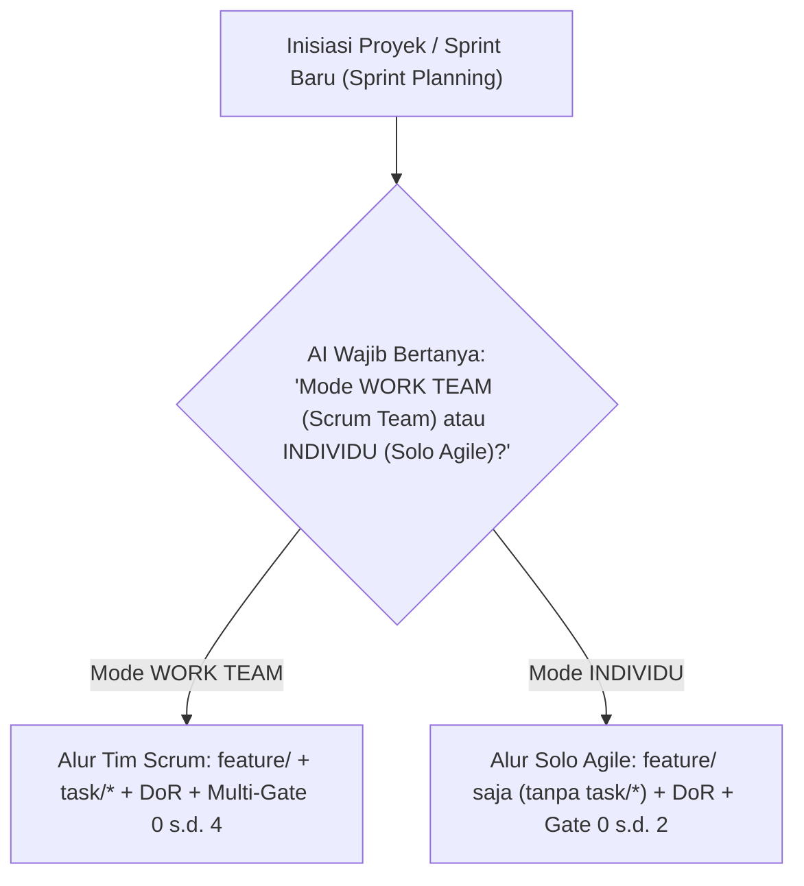

# SIKLUS HIDUP SPRINT / MILESTONE & GERBANG PENETAPAN DELEGASI (SPRINT PLANNING & ASSIGNMENT GATE)
# Version: 3.0.0 | Date: 2026-10-30 | Scope: Agile Sprint Planning, DoR/DoD, JIT Branching, gh-Only Identity & Post-Merge Cleanup

> [!NOTE]
> Dokumen ini adalah spesifikasi rujukan detail siklus Sprint & milestone. Jika terdapat pertentangan, `.governance/CORE-RULES.md` adalah Single Source of Truth tertinggi yang berlaku.

Untuk mencegah asumsi sepihak, perpindahan peran liar, atau overhead yang tidak diperlukan, inisiasi pengerjaan proyek/Sprint/milestone wajib diawali dengan **Sprint Planning** dan penentuan **Dual Execution Mode**:
1. **Mode WORK TEAM (Multi-Worker Scrum Team Track)**: Untuk pengerjaan tim Scrum multi-developer dengan task branches dan siklus Multi-Gate penuh (DoR + Gate 0 s.d. Gate 4).
2. **Mode INDIVIDU (Solo Agile Track)**: Untuk pengerjaan solo developer cukup pada cabang `feature/TASK-XXX` (tanpa membuat cabang `task/*`) dengan gerbang ringkas (DoR + Gate 0 s.d. Gate 2 saja).

---

## 1. Rincian Status State Machine dalam Siklus Sprint

* **State 1 (Gate 3 PR Merged & Burndown Updated)**: PR tugas unit kerja telah berhasil ditinjau dan digabungkan (*merged*) ke dedicated branch integrasi Sprint (`feature/*`), serta *Story Points* pada **Sprint Burndown** telah diperbarui.
* **State 2 (Post-Merge Remote Branch Cleanup)**: Pembersihan task branch yang telah ter-merge sesuai protokol pembersihan branch (hapus branch remote di GitHub via `git push origin --delete <branch>` atau `gh api -X DELETE`, serta lokal via `git branch -d`).
* **State 3 (Mandatory Sprint Assignment Gate - Gerbang Henti Mutlak AI)**:
  - AI **DILARANG KERAS** melompati State 3 langsung ke State 6 atau berasumsi sepihak bahwa sesi langsung berpindah ke worker berikutnya.
  - AI **WAJIB SECARA PROAKTIF** berhenti dan mengajukan pertanyaan eksplisit kepada Human Product Owner:
    > *"Pull Request untuk Worker-X telah resmi di-merge ke branch Sprint, Story Points telah diperbarui pada Sprint Burndown, dan branch tugas lama di GitHub telah dibersihkan. Kepada Scrum Developer / kolaborator siapa item Sprint Backlog berikutnya (Worker-(X+1)) akan didelegasikan?"*
* **State 4 (Product Owner Delegation Decision & Collaborator Verification Loop)**:
  - Human Product Owner menetapkan calon developer / kolaborator.
  - **Validasi Akun Remote**: Lead AI memvalidasi akun tersebut pada repositori GitHub via `gh api user` dan Permission API.
  - Jika akun tidak valid/tidak ditemukan, AI dilarang mengubah status board menjadi assigned (`READY`) dan wajib meminta re-assignment kepada Product Owner.
* **State 5 (Scrum Board & Sprint Backlog Update)**:
  - AI memperbarui `.ai/TEAM-BOARD.md` dan `.ai/current-task.md` **hanya setelah** akun kolaborator terverifikasi sah di GitHub dan **Definition of Ready (DoR)** terpenuhi.
* **State 6 (gh-Only Identity Handshake, User Story Handoff & Autonomous Task Design)**:
  - Developer yang ditugaskan beralih/checkout ke task branch.
  - **Verifikasi Identitas gh-Only**: Worker AI memeriksa sesi resmi `gh api user` di terminal.
    - Sesi aktif wajib cocok dengan penugasan Product Owner di board.
    - `git config user.name/email` dilarang digunakan sebagai bukti identitas.
    - Jika belum login atau sesi tidak cocok: Worker AI **WAJIB MENOLAK MEMPROSES APA PUN DAN BERHENTI TOTAL**.
  - Lead AI menyerahkan Briefing: **Sprint Goal**, **User Story (`US-XXX`) & Acceptance Criteria (Given-When-Then)**, **Story Points**, Batasan Arsitektur (*Architectural Boundaries*), dan Kontrak Antar-Modul (*Contracts*).
  - Worker AI mengaktifkan mode Worker Unit dan secara mandiri merumuskan solusi teknis (the "HOW") ke dalam **Implementation Plan mandiri** pada artefak (`implementation_plan.md`).
  - Worker AI **BERHENTI PENUH** menunggu persetujuan dari Human Developer mitranya.
* **State 7 (Sprint Execution, Daily Standup & Multi-Gate DoD Testing)**:
  - Setelah Human Developer meninjau dan menekan tombol **"proses"**, Worker AI mulai menulis kode dengan disiplin backup `.trash/`, menjalankan Gate 1 (DoD Level 1: 100% lulus), memperbarui *Daily Scrum Standup Log*, menyusun checklist Gate 2 (DoD Level 2: status `PENDING` beserta skenario *Given-When-Then*), dan berhenti total menyerahkan verifikasi kepada Human Developer.

---

## 2. Product Backlog Refinement, Sprint Planning & Just-In-Time (JIT) Branch Provisioning
1. **Backlog Refinement & Upfront Sprint Blueprinting**:
   - Di awal proyek/Sprint, Product Owner bersama Lead Orchestrator / Scrum Master AI merumuskan **Product Backlog** (`docs/09-development-plan.md`), menetapkan **Sprint Goal**, menyusun *User Stories*, estimasi *Story Points*, batas domain direktori, dan matriks ketergantungan tugas secara utuh pada `.ai/TEAM-BOARD.md`.
2. **Larangan Keras Pembuatan Cabang Prematur (No Premature Branching)**:
   - Cabang Git fisik (`feature/*` dan `task/*`) **DILARANG KERAS DIBUAT DI GIT** sebelum tugas tersebut memenuhi **Definition of Ready (DoR)** dan seluruh prasyarat arsitektur hulu telah 100% selesai, lulus Gate 3, serta terintegrasi di upstream.
3. **Pemicu Otomatis Pemenuhan Prasyarat**:
   - Segera setelah item/Sprint hulu selesai, Lead AI secara proaktif mengonfirmasi inisialisasi cabang Git kepada Product Owner sebelum cabang fisik dibuat.

---

## 3. Aturan Retensi Cabang Pasca-Merge & Protokol Standby
1. **Larangan Checkout Otomatis**:
   - Setelah sebuah Pull Request selesai di-merge, AI dilarang melakukan `git checkout` ke cabang lain secara otomatis.
2. **Kewajiban Menetap di Cabang Integrasi Sprint Aktif**:
   - AI dan Human Product Owner tetap berada di cabang integrasi aktif (`feature/*`) dalam status STANDBY.
3. **Pengecualian**:
   - AI hanya diizinkan berpindah cabang jika terdapat perintah langsung yang eksplisit dari Human Product Owner.
