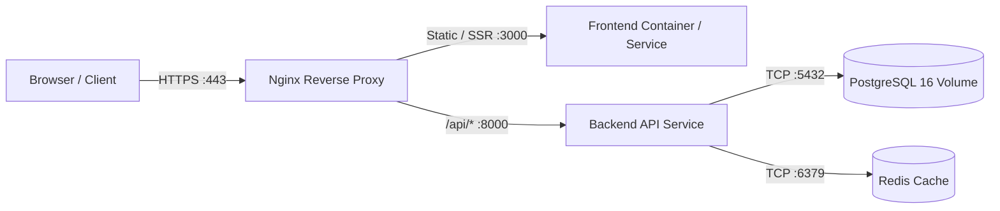

# STANDAR INFRASTRUKTUR, TOPOLOGI DEPLOYMENT & KESIAPAN OPERASIONAL (`docs/05-infrastructure.md`)
# Version: 1.0.0 | Date: 2026-10-30 | Scope: Early Infrastructure Decision (Stage 2 Sprint 0), Containerization, Environment & CI/CD

> [!IMPORTANT]
> **ATURAN PENENTUAN INFRASTRUKTUR DI HULU (STAGE 2 SPRINT 0)**:
> Spesifikasi infrastruktur **WAJIB** digali melalui wawancara dengan pengguna dan disahkan di `docs/05-infrastructure.md` pada **Stage 2 Sprint 0** (bersama `docs/04-architecture.md`), **SEBELUM** AI merancang skema Database (`docs/06-database.md`), Kontrak API (`docs/07-api.md`), UI/UX (`docs/08-ui-ux.md`), Keamanan (`docs/09-security.md`), maupun Sprint Development Plan (`docs/10-development-plan.md`).
> AI **DILARANG KERAS** mengasumsikan sendiri apakah proyek menggunakan Docker, SQLite vs PostgreSQL, atau menebak port/hosting secara sepihak!

---

## 1. Tujuh Pilar Wajib dalam `docs/05-infrastructure.md`

Setiap dokumen `docs/05-infrastructure.md` wajib memuat hasil kesepakatan wawancara pengguna atas 7 pilar berikut:

### 1. Target Hosting & Compute Environment
- Menetapkan secara eksplisit target eksekusi aplikasi:
  - **Local Native / Desktop Daemon** (macOS / Linux / Windows).
  - **On-Premise Baremetal / Dedicated Server**.
  - **Cloud VPS / VM** (AWS EC2, GCP Compute Engine, DigitalOcean Droplet, Alibaba Cloud, dll.).
  - **Managed PaaS / Serverless** (Cloud Run, Vercel, Railway, Render, Fly.io) atau **Kubernetes (K8s)**.

### 2. Strategi Runtime & Containerization
- Menentukan apakah pengembangan dan produksi menggunakan:
  - **Containerized (`Dockerfile` + `docker-compose.yml`)**: Menjamin paritas penuh antara lokal dan produksi.
  - **Native Runtime**: Menggunakan manajer paket dan process supervisor lokal (`python -m venv`, `systemd`, `pm2`, `supervisord`).
  - **Hybrid**: Database/Redis berjalan di Docker, sedangkan aplikasi backend/frontend berjalan secara native saat development.

### 3. Infrastruktur Data, Caching & Storage
- Menentukan layanan pendukung yang harus disediakan oleh infrastruktur sebelum merancang ERD di `docs/06-database.md`:
  - **Primary Database Engine & Versi**: (misal: PostgreSQL 16, MySQL 8.0, SQLite 3, MongoDB).
  - **In-Memory Cache / Message Broker**: (misal: Redis, RabbitMQ, Kafka, atau In-Process Memory).
  - **File / Object Storage**: (misal: Local Filesystem Volume, AWS S3, Google Cloud Storage, MinIO).

### 4. Topologi Jaringan, Alokasi Port & Reverse Proxy
- Menetapkan tabel alokasi port eksplisit agar tidak terjadi bentrok (*port collision*):
  - Contoh: Frontend Web (`:5173` dev / `:80` prod), Backend API (`:8000`), Database (`:5432`), Cache (`:6379`).
- Menentukan penggunaan **Reverse Proxy / API Gateway** (Nginx, Traefik, Caddy, Cloudflare Tunnel) dan terminasi SSL/TLS (HTTPS).

### 5. Manajemen Konfigurasi & Environment Variables (`.env.example`)
- Pemisahan profil environment: `development`, `staging`, dan `production`.
- Kewajiban menyediakan berkas `.env.example` yang mendokumentasikan seluruh variabel konfigurasi tanpa menyertakan *secret* asli di Git.

### 6. CI/CD Pipeline & Strategi Rilis
- Menentukan alur otomatisasi pengujian (**Gate 1 Automated Tests**) dan build pada platform Git (GitHub Actions / GitLab CI) saat Pull Request diajukan ke `feature/*`, `development`, dan `master`.

### 7. Observability, Healthcheck, Logging & Backup
- **Healthcheck Endpoint**: Setiap layanan backend wajib menyediakan endpoint pemeriksaan kesehatan (misal: `GET /healthz` atau `GET /api/health`) yang memeriksa konektivitas database/dependency.
- **Structured Logging**: Standar output log (`stdout`/`stderr` JSON atau rotasi file di `logs/`).
- **Disaster Recovery & Backup**: Strategi pencadangan volume database dan prosedur rollback rilis.

---

## 2. Kewajiban Diagram Topologi Infrastruktur pada `implementation_plan.md` Stage 2

Sebelum menulis `docs/05-infrastructure.md`, AI **WAJIB** menyajikan diagram topologi infrastruktur menggunakan Mermaid `flowchart` di dalam `implementation_plan.md` untuk ditinjau pengguna, contohnya:

