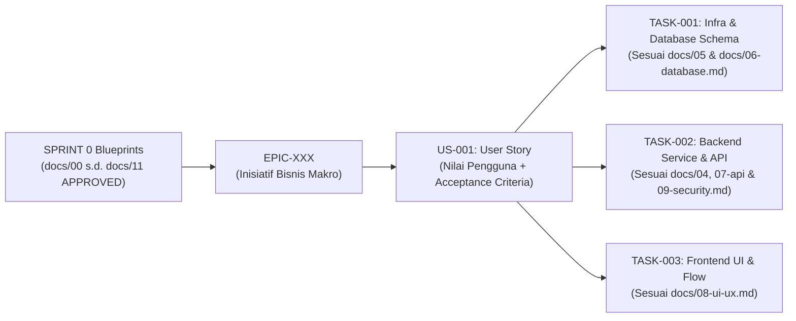

# PROTOKOL MANAJEMEN PROYEK AGILE & SCRUM PADA UNIVERSAL AI-SDLC
# Version: 1.2.0 | Date: 2026-10-30 | Scope: Sprint 0 Interactive Blueprinting (`docs/00`–`11` with Early Infrastructure at `05`), Scrum Roles, Artifacts, Ceremonies, DoR/DoD, Granular Task Decomposition & Velocity

> [!NOTE]
> Dokumen ini adalah spesifikasi rujukan manajemen proyek Agile & Scrum di dalam kerangka kerja Universal AI-SDLC. Jika terdapat pertentangan, `.governance/CORE-RULES.md` adalah Single Source of Truth tertinggi yang berlaku.

---

## 1. Prinsip Dasar Integrasi Agile, Sprint 0 Blueprinting & AI-SDLC

Kerangka kerja **Universal AI-SDLC** menggabungkan kelincahan iteratif dari **Agile & Scrum** (*Scrum Guide*) dengan kedalaman rekayasa perangkat lunak melalui **Sprint 0 (5-Stage Interactive Discovery & Blueprinting `docs/00` s.d. `docs/11`)** dan **Multi-Gate Quality Protocol 0–4**:
1. **No AI Solo Imagination (Wawancara Mendalam Sebelum Koding)**:
   - Baik dikerjakan dalam mode **`WORK TEAM`** maupun **`INDIVIDU`**, AI dilarang keras mengarang sendiri proses bisnis, arsitektur, **infrastruktur/deployment (`docs/05-infrastructure.md`)**, relasi tabel database (`docs/06-database.md`), kontrak API (`docs/07-api.md`), maupun tata letak/mockup UI/UX (`docs/08-ui-ux.md`).
   - Seluruh proyek wajib diawali dengan **Sprint 0**, yaitu 5 tahap wawancara mendalam dan persetujuan bertahap (*Plan & Proceed*) secara berurutan dari Hulu ke Hilir untuk menghasilkan `docs/00-project-overview.md` s.d. `docs/11-test-plan.md` dengan status `APPROVED`.
2. **Granular Iterative & Incremental Delivery (Larangan 1 Task Full-Stack)**:
   - Setelah `docs/00` s.d. `docs/11` disahkan pada Sprint 0, implementasi kode **WAJIB DIPECAH** menjadi beberapa Task/Sprint modular (`TASK-001`, `TASK-002`, `TASK-003`, dst.).
   - **DILARANG KERAS** menggabungkan pembuatan seluruh aplikasi full-stack (Infra + Database + Backend + Frontend + Tests) ke dalam satu `TASK-001` tunggal!
3. **Empirical Process Control (Transparency, Inspection, Adaptation)**:
   - **Transparency**: Seluruh status *Sprint Backlog*, *Story Points*, *Burndown*, dan *Daily Standup* terlihat secara real-time di `.ai/TEAM-BOARD.md` dan `.ai/current-task.md`.
   - **Inspection**: Setiap *Increment* wajib melewati pemeriksaan berlapis **Gate 0 s.d. Gate 4**.
   - **Adaptation**: Temuan kegagalan pada Gate 2 atau Gate 4 segera diadaptasi melalui *Loopback Protocol* (RCA + Plan Version Bump) dan dievaluasi pada **Sprint Retrospective**.

---

## 2. Hierarki Kebutuhan Agile (Epics $\rightarrow$ User Stories $\rightarrow$ Granular Technical Tasks)

Seluruh pekerjaan teknis di dalam repositori wajib dapat ditelusuri kembali (*traceable*) ke dokumen blueprint `docs/00`–`11` (khususnya `docs/03-prd.md` dan `docs/10-development-plan.md`):



### A. Format Standar User Story (`US-XXX`)
Setiap fitur wajib dirumuskan dalam format standar Agile:
```markdown
### [US-XXX] <Judul Singkat Fitur>
- **Epic Induk**: EPIC-XXX
- **Prioritas**: [MUST HAVE (P0) | SHOULD HAVE (P1) | COULD HAVE (P2) | WON'T HAVE (P3)]
- **Estimasi**: <1 | 2 | 3 | 5 | 8> Story Points (Skala Fibonacci)
- **Referensi Blueprint**: `docs/02-business-process.md`, `docs/05-infrastructure.md`, `docs/06-database.md`, `docs/07-api.md`, `docs/08-ui-ux.md`
- **Narasi User Story**:
  > **Sebagai** `<peran/persona pengguna>`,
  > **Saya ingin** `<kapabilitas/tindakan yang diinginkan>`,
  > **Agar** `<nilai bisnis/manfaat yang diperoleh>`.
```

### B. Format Standar Acceptance Criteria (BDD Given-When-Then)
Setiap *User Story* wajib memiliki kriteria penerimaan yang dapat diuji secara deterministik pada **Gate 1 (Unit Test)** dan **Gate 2 (Manual Operational Verification)**:
```markdown
- **Acceptance Criteria (AC)**:
  1. **AC-1 (Happy Path)**:
     - **Given** (Prasyarat awal sistem/data)
     - **When** (Aksi spesifik yang dijalankan pengguna/API)
     - **Then** (Hasil akhir sistem yang wajib teramati)
  2. **AC-2 (Negative / Edge Case / Security)**:
     - **Given** ...
     - **When** ...
     - **Then** ...
```

### C. Panduan Estimasi Story Points & Aturan Dekomposisi Granular
| Story Points (SP) | Kompleksitas & Cakupan Teknis | Aturan Dekomposisi |
| :---: | :--- | :--- |
| **1 SP** | Perubahan konfigurasi, perbaikan bug minor, atau komponen terisolasi sederhana. | Siap dieksekusi langsung. |
| **2 – 3 SP** | Fitur standar satu lapisan (misal: provisioning Docker + skema DB, atau 1 grup endpoint API) dengan *unit test*. | Ukuran ideal untuk 1 task branch. |
| **5 SP** | Fitur satu modul utuh dengan logika bisnis menengah yang patuh pada `docs/05`–`09`. | Ukuran maksimum yang disarankan per task pada mode Solo/Team. |
| **8 SP** | Fitur kompleks dengan integrasi eksternal atau perubahan skema signifikan. | Disarankan dipecah menjadi 2 task berurutan (`TASK-00X`, `TASK-00Y`). |
| **13+ SP** | Terlalu besar (*Full-Stack One-Shot / Epic*) dengan risiko halusinasi AI tinggi. | **DILARANG DIEKSEKUSI SEKALIGUS! Wajib dipecah menjadi beberapa Task ($\le 5$ SP)!** |

---

## 3. Definition of Ready (DoR) vs Definition of Done (DoD)

### A. Definition of Ready (DoR) — Gerbang Masuk Sprint Execution
Sebuah item *Sprint Backlog* (`US-XXX` / `TASK-XXX`) **DILARANG** masuk ke tahap koding kecuali seluruh poin **DoR** berikut terpenuhi pada saat Pre-Flight & `implementation_plan.md`:
- [ ] **DoR-0 (Sprint 0 Blueprint Approved)**: Seluruh dokumen `docs/00-project-overview.md` s.d. `docs/11-test-plan.md` (termasuk `docs/05-infrastructure.md`) telah selesai digali melalui wawancara 5 tahap dan berstatus `Status: APPROVED`.
- [ ] **DoR-1 (Clear Value & Narrative)**: Memiliki ID *User Story* / *Task* yang jelas dan selaras dengan *Sprint Goal*.
- [ ] **DoR-2 (Testable Acceptance Criteria)**: Memiliki skenario *Given-When-Then* yang tidak ambigu dan merujuk ke Infra (`docs/05`), ERD (`docs/06`), API (`docs/07`), serta Mockup UI (`docs/08`).
- [ ] **DoR-3 (Granularly Sized & Isolated)**: Memiliki estimasi *Story Points* ($\le 8$ SP; bukan 1 task full-stack raksasa) dan batas direktori domain yang terisolasi.
- [ ] **DoR-4 (Dependency Cleared)**: Seluruh tugas prasyarat hulu telah berstatus `MERGED` / `DONE`.
- [ ] **DoR-5 (Verified Assignee - Gate 0)**: Pengembang pelaksana telah ditunjuk oleh Product Owner dan terverifikasi via `gh api user`.

### B. Definition of Done (DoD) — Gerbang Kelulusan Increment
Sebuah *User Story / Task* hanya sah berstatus **DONE (`MERGED` / `COMPLETED`)** apabila lulus seluruh lapisan **Multi-Gate DoD**:
- [ ] **DoD Level 1 (Gate 1 - AI Automated Quality)**: Seluruh *unit test*, *integration test*, *linter*, dan kompilasi lulus 100% tanpa error/race condition.
- [ ] **DoD Level 2 (Gate 2 - Human Operational & AC Verification)**: Seluruh skenario *Acceptance Criteria (Given-When-Then)* telah diuji secara nyata di terminal/runtime oleh Human Developer dan ditandai `[x] PASSED`.
- [ ] **DoD Level 3 (Gate 3 - Peer/PO Code Review & Branch Hygiene)**: Pull Request telah ditinjau dan di-merge oleh Product Owner, papan Scrum/Burndown diperbarui, dan cabang remote `task/*` telah dihapus.
- [ ] **DoD Level 4 (Gate 4 - Sprint Review & Smoke Acceptance)**: *Increment* terintegrasi telah lulus uji *Smoke Test* oleh Product Owner terhadap *Sprint Goal* dan siap dirilis ke `development`.

---

## 4. Pelaksanaan 6 Seremoni Scrum (Scrum Events) dalam AI-SDLC

1. **Sprint 0: 5-Stage Interactive Customer Discovery & Blueprinting (`docs/00`–`11`)**:
   - Menjalankan 5 putaran wawancara mendalam & persetujuan `implementation_plan.md` bertahap untuk menyusun `docs/00`–`03` (Stage 1: Bisnis & PRD), `docs/04`–`05` (Stage 2: Arsitektur & Infrastruktur di Hulu), `docs/06`–`07` (Stage 3: Database ERD & API), `docs/08`–`09` (Stage 4: UI/UX Mockup & Security), serta `docs/10`–`11` (Stage 5: Granular Sprint Backlog & Test Plan).
2. **Product Backlog Refinement & Sprint Planning**:
   - Menentukan **Sprint Goal**, memilih mode `WORK TEAM` atau `INDIVIDU`, memilih *Granular Tasks* dari `docs/10-development-plan.md` ke `.ai/TEAM-BOARD.md`, memverifikasi **DoR**, dan menetapkan penugasan developer.
3. **Daily Scrum (Asynchronous AI-Human Standup Sync)**:
   - Memperbarui blok **Daily Standup** (*Done Since Last Sync*, *Active Sprint Focus*, *Impediments/Blockers*) di `.ai/current-task.md` dan `.ai/TEAM-BOARD.md`.
4. **Sprint Execution & Quality Inspection (Gate 1 – Gate 3)**:
   - Eksekusi kode per Task modular dengan disiplin `.trash/` (`BypassSandbox: false`), pengujian otomatis (**Gate 1**), pengujian operasional manusia (**Gate 2**), dan penggabungan PR (**Gate 3**).
5. **Sprint Review (Gate 4 Final Acceptance)**:
   - Product Owner menginspeksi dan menguji langsung *Increment* perangkat lunak terhadap *Sprint Goal* (`COMPLETED` atau `REVISE`).
6. **Sprint Retrospective (Post-Sprint Continuous Improvement)**:
   - Mencatat evaluasi *Sprint Velocity*, *What Went Well*, *Loopback RCA*, dan *Action Items* pada penutupan Sprint.
